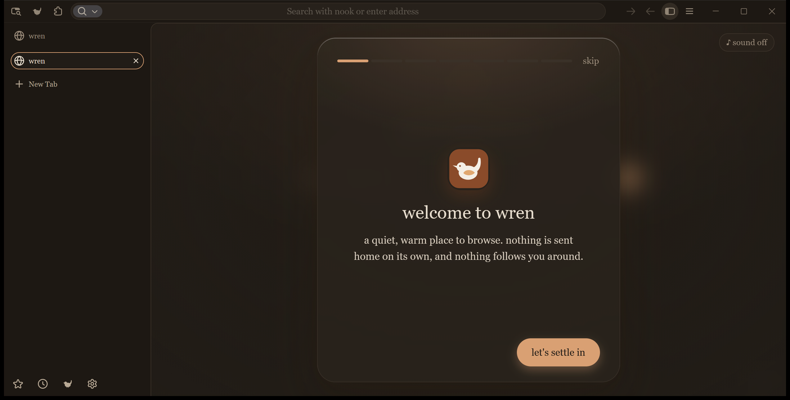
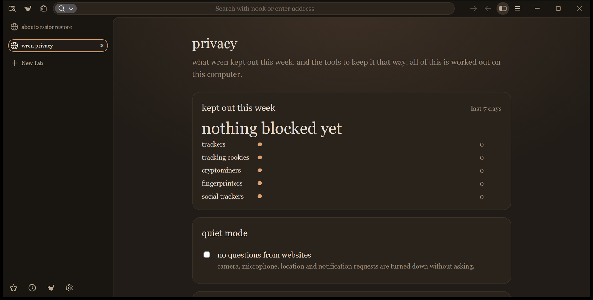
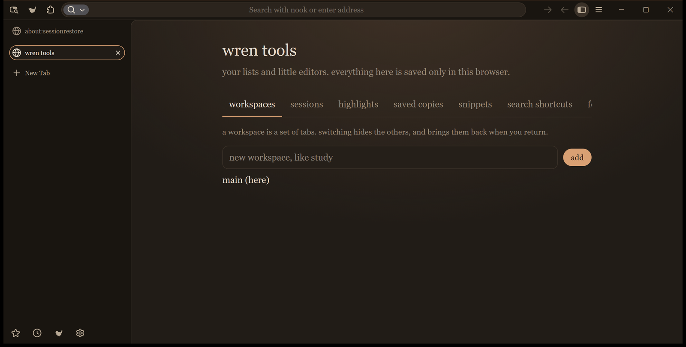
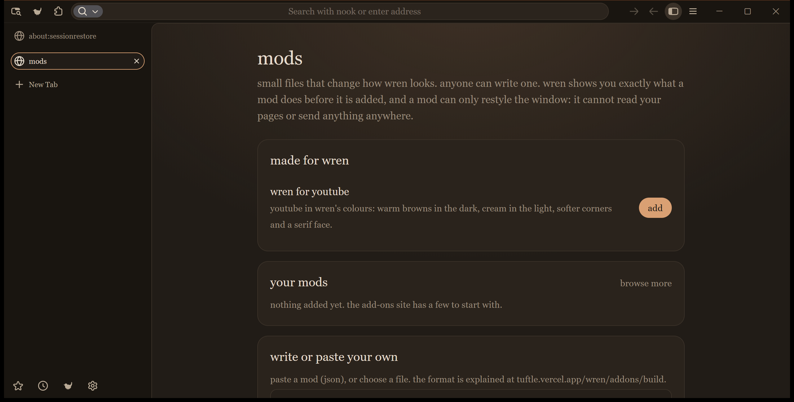

<div align="center">


# Wren

A browser built on Firefox, with a calm interface, private defaults and no accounts.

[](LICENSE)
[](#install)
[](BASE)
[](https://github.com/Tuftle/wren/releases/latest)

[Download](https://github.com/Tuftle/wren/releases/latest) &ensp;◆&ensp; [Add-ons and mods](https://tuftle.vercel.app/wren/addons) &ensp;◆&ensp; [Building](docs/BUILDING.md) &ensp;◆&ensp; [Privacy](#privacy)

</div>

<br>



<br>

## ◆ Overview

Wren is a fork of Firefox that changes how the browser looks, what it does by default and what it keeps to itself. It runs
the Gecko engine, supports Firefox extensions, and reads the same web as any other modern browser.

| | |
| :-- | :-- |
| **Interface** | Warm cream and brown palette, serif type, vertical tabs, lowercase wording. |
| **Search** | [nook](https://nooksearch.vercel.app) is the default engine. Other engines can be chosen on first run. |
| **Privacy** | Tracker blocking on by default. No account, no sync service, no telemetry. |
| **Customisation** | Mods restyle the window and individual sites. Each mod is shown in full before it is added. |
| **Import** | Bookmarks, history, cookies and extensions can be brought over from a Firefox profile. |

---

## ◆ Install

**Windows 10 and 11, 64-bit.**

1. Download `Wren-Setup.exe` from the [latest release](https://github.com/Tuftle/wren/releases/latest).
2. Run it. It installs for the current user into `%LOCALAPPDATA%\Programs\Wren`, so no administrator rights are needed.
3. On first launch Wren offers to import from an existing Firefox profile.

> The installer is not code-signed yet, so Windows SmartScreen may warn on first run. The SHA-256 of each release file is
> listed in the release notes.

To remove Wren, use Windows Settings, then Apps, or run `%LOCALAPPDATA%\Programs\Wren\uninstall\helper.exe`. Bookmarks,
history and settings are kept unless you choose to delete them.

---

## ◆ What is in it

<table>
<tr>
<td width="50%" valign="top">

**Everyday**

- ✦ Command palette for every action (`Alt+Shift+K`)
- ✦ Jump to any open or recently closed tab
- ✦ Per-site dark mode, zoom and script blocking
- ✦ Reading time, clean PDF export, read aloud
- ✦ Notes, a sheet and a drawing page built in
- ✦ On-device page translation

</td>
<td width="50%" valign="top">

**Calm**

- ✦ Focus mode that hides the bars and quiets notifications
- ✦ Rain, fireplace and cafe sounds
- ✦ Bedtime mode and evening shade
- ✦ Rooms with separate cookies for work and home
- ✦ A start page that changes with the time of day
- ✦ Comfort settings for type, size and motion

</td>
</tr>
<tr>
<td width="50%" valign="top">

**Private**

- ✦ Weekly report of what was kept out
- ✦ Quiet mode that declines permission prompts
- ✦ Tracking parameters removed from links
- ✦ A panic button that forgets everything and closes
- ✦ Guest windows
- ✦ Password audit that never leaves the device

</td>
<td width="50%" valign="top">

**Organised**

- ✦ Trail map of how you moved between pages
- ✦ Bookshelf view of bookmarks, with dead-link checking
- ✦ Group tabs by site, sleep idle tabs
- ✦ Reminders and page-change watching
- ✦ Saved sessions and workspaces
- ✦ Year-in-review built from local history

</td>
</tr>
</table>

<br>

<table>
<tr>
<td width="50%"></td>
<td width="50%"></td>
</tr>
<tr>
<td align="center"><sub>Privacy report</sub></td>
<td align="center"><sub>Tools</sub></td>
</tr>
</table>

---

## ◆ Mods

A mod is a small JSON file that changes colours, spacing and fonts. Wren shows exactly what a mod does before it is added,
and a mod that restyles the window cannot read pages or send anything anywhere.

Mods can also style specific websites. **wren for youtube** ships with the browser and gives YouTube the same palette and
type as the rest of Wren.



The mod format is documented at [tuftle.vercel.app/wren/addons/build](https://tuftle.vercel.app/wren/addons/build).

---

## ◆ Privacy

Wren sends no telemetry, runs no studies or experiments, and has no accounts. Two of Wren's own features contact a server
run by Tuftle. Both are small, and the second only runs when you press a button.

| What | When | What is sent |
| :-- | :-- | :-- |
| **Update check** | Twice a day | Nothing about you. Wren downloads one small public file, [`latest.json`](https://tuftle.vercel.app/wren/latest.json), and compares build numbers. |
| **"This site looks weird" report** | Only when you press send | The site name, a random report code and the time. The dialog shows this before anything is sent. Later, Wren asks about that code alone to learn whether it was fixed. |

Both go to a server run by Tuftle, which can see your IP address for the length of the request and does not store it. The
web host may keep ordinary server logs. There are no accounts, identifiers or analytics. The relay is open source in the
[tuftle repository](https://github.com/Tuftle/tuftle/tree/main/api).

---

## ◆ Updates

Wren checks for a newer build in the background. When one exists it says so once, and the **updates** page offers an
**update and restart** button. The download is checked against the SHA-256 announced with it, and only a few addresses
are trusted as a source. The installer then waits for Wren to close, replaces the program files, keeps the profile and
opens Wren again.

---

## ◆ Repository layout

```
wren/
├── overlay/              Wren's changes, laid out as paths inside a Firefox source tree
│   ├── browser/branding/wren/        name, icons, installer art
│   ├── browser/extensions/wren/      the built-in extension: start page, tools, mods, updates
│   ├── browser/themes/               theme and shared styles
│   ├── toolkit/                      settings pages, add-ons manager, search
│   └── tools/wren/                   icon generation scripts
├── overlay-deleted.txt   files that Wren removes from the Firefox tree
├── build/                mozconfig files for a full build and for a quick artifact build
├── installer/            the installer and uninstaller program (Rust)
├── scripts/              apply the overlay to a Firefox checkout
├── docs/                 build guide and screenshots
└── BASE                  the Firefox revision the overlay was made against
```

Firefox is more than a gigabyte of source, so this repository holds only what Wren changes. `scripts/apply-overlay`
copies those files onto a checkout of the revision named in [BASE](BASE).

---

## ◆ Building

The short version:

```
git clone https://github.com/mozilla-firefox/firefox
cd firefox && git checkout c32abda0190531351e22da36334f18f9e994d474
..\wren\scripts\apply-overlay.ps1 .
./mach bootstrap
./mach build
./mach package
```

The full guide, including the installer and the update file, is in [docs/BUILDING.md](docs/BUILDING.md). A first full
build takes a few hours on a fast machine.

---

## ◆ Related

| | |
| :-- | :-- |
| **[nook](https://github.com/Tuftle/nook)** | The search engine Wren uses by default. |
| **[tuftle](https://github.com/Tuftle/tuftle)** | The website, add-ons catalogue and the small server functions Wren talks to. |

---

## ◆ Licence

Wren is released under the [Mozilla Public License 2.0](LICENSE), the same licence as Firefox. Firefox and the Firefox
logo are trademarks of the Mozilla Foundation; Wren is not affiliated with or endorsed by Mozilla.

<div align="center">

<br>

◆ &ensp; ◆ &ensp; ◆

<sub>Made by <a href="https://github.com/Tuftle">tuftle</a></sub>

</div>
